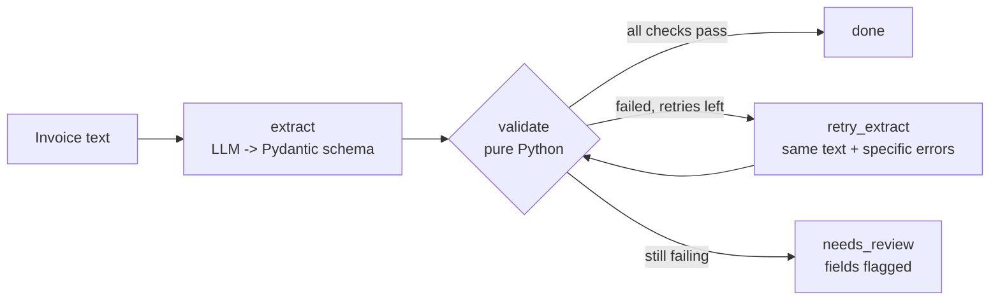

# llm-invoice-extractor

LLMs are good at reading invoices and bad at adding them up. This repo is a small,
working reference for the pattern I use to get structured data out of supplier
invoices: the model reads, plain Python checks the arithmetic, and anything that
still does not add up goes to a person with the exact field flagged.

It is a clean re-implementation of a pipeline I built for an accounts-payable team
to replace template-based OCR. All company names and figures here are fictional.

## The problem

Template OCR breaks every time a supplier changes their layout. An LLM handles
layout variation well, but it can misread a digit, transpose a total, or
"helpfully" adjust a number so the invoice looks right. In finance, a confident
wrong number is worse than no number.

## How it works



1. **Extract.** The model fills a Pydantic v2 schema (`Invoice`, `LineItem`) using
   structured output. It is told to copy numbers exactly as printed and not to
   calculate anything.
2. **Validate in code.** `validation.py` checks, with `Decimal` and a 0.01 tolerance:
   - each line: `quantity x unit_price == amount`
   - `sum(line_items) == subtotal`
   - `subtotal + tax == total`
   - dates parse as ISO 8601 and the due date is not before the invoice date
   - no negative totals, at least one line item
3. **Retry once with the specific error.** The failure messages go back to the model,
   e.g. `total: subtotal + tax = 1366.75 but total is 1636.75`. A targeted message
   is far more useful to the model than "try again".
4. **Route to human review.** If it still fails, the result is marked
   `needs_review` with `flagged_fields`, so the reviewer checks one field instead
   of re-keying the whole invoice.

The pipeline is a LangGraph `StateGraph` with nodes `extract`, `validate`,
`retry_extract`, `needs_review` and `done`. The retry limit is configurable
(`--max-retries`, default 1).

## Why validate in code

- **Arithmetic is deterministic, so check it deterministically.** Asking a model
  whether totals add up gives you a probability. `Decimal` gives you a fact.
- **The model should not be its own auditor.** If the same model extracts and
  checks, the same blind spot can produce and approve the error.
- **Failures become specific.** A rule that fails knows which field is wrong. That
  makes the retry prompt sharp and the human review fast.
- **It is testable.** The validation module has no LLM dependency and is covered by
  unit tests that run in milliseconds.
- **Some invoices really are wrong.** Suppliers make mistakes. The retry prompt
  tells the model to keep numbers as printed and never change them to make the
  totals balance, so a genuinely inconsistent invoice ends up with a person
  instead of being quietly "fixed".

## Quickstart

Requires Python 3.11+.

```bash
git clone https://github.com/Ade-tobii/llm-invoice-extractor.git
cd llm-invoice-extractor
python -m venv .venv
source .venv/bin/activate        # Windows: .venv\Scripts\activate
pip install -r requirements.txt

# No API key needed: replays recorded model responses
python -m invoice_extractor samples/harbor_light_logistics.txt --demo

pytest
```

With a real model:

```bash
cp .env.example .env              # then set GOOGLE_API_KEY
export GOOGLE_API_KEY=...         # or load .env however you prefer
python -m invoice_extractor samples/northwind_supplies.txt
```

The default model is `gemini-2.5-flash`; override it with `GEMINI_MODEL`.
JSON goes to stdout and progress logs to stderr. The exit code is `0` for `done`
and `2` for `needs_review`, so the CLI is easy to script.

## The three samples

| Sample | What happens |
|---|---|
| `northwind_supplies.txt` | Clean read, passes first time. |
| `harbor_light_logistics.txt` | The model reads the total as 1,636.75 instead of 1,366.75. Validation catches it, the error goes back, the retry reads it correctly. |
| `crestline_facility_services.txt` | The invoice itself is wrong: line items sum to 1,180.00 but the printed subtotal is 1,130.00. The retry fixes a date format but keeps the subtotal as printed, so it goes to review. |

In `--demo` mode the model is replaced by `FakeExtractor`, which replays the
responses in `samples/demo_responses/`. These are hand-written to show each path
through the graph.

## Example output

```text
$ python -m invoice_extractor samples/crestline_facility_services.txt --demo
[INFO] attempt 1 failed: subtotal: line items sum to 1180.00 but subtotal is 1130.00; invoice_date: '19/01/2026' is not a YYYY-MM-DD date; due_date: '18/02/2026' is not a YYYY-MM-DD date
[INFO] attempt 2 failed: subtotal: line items sum to 1180.00 but subtotal is 1130.00
```

```json
{
  "status": "needs_review",
  "attempts": 2,
  "flagged_fields": ["subtotal"],
  "issues": [
    {"field": "subtotal", "message": "line items sum to 1180.00 but subtotal is 1130.00"}
  ],
  "invoice": {
    "vendor_name": "Crestline Facility Services",
    "invoice_number": "CFS/2026/0097",
    "invoice_date": "2026-01-19",
    "due_date": "2026-02-18",
    "currency": "USD",
    "line_items": [
      {"description": "Quarterly HVAC service", "quantity": "1", "unit_price": "640.00", "amount": "640.00"},
      {"description": "Air filter replacement", "quantity": "12", "unit_price": "35.00", "amount": "420.00"},
      {"description": "Call-out fee", "quantity": "1", "unit_price": "120.00", "amount": "120.00"}
    ],
    "subtotal": "1130.00",
    "tax": "56.50",
    "total": "1186.50"
  }
}
```

Money is serialised as strings so no precision is lost on the way to the next system.

## Project layout

```text
invoice_extractor/
  models.py       Pydantic schema (Decimal money, tolerant parsing of "1,242.50")
  validation.py   Pure-Python business rules; no LLM imports
  extractors.py   Extractor protocol, GeminiExtractor, FakeExtractor, prompts
  graph.py        LangGraph StateGraph and process_invoice()
  __main__.py     CLI
samples/          Fictional invoices + recorded responses for --demo
tests/            Validation unit tests and graph/CLI tests (offline)
```

## Design decisions

- **The LLM sits behind a one-method protocol.** `extract(text, feedback) -> Invoice`.
  The graph does not know which provider it is talking to, and tests use a scripted
  fake instead of mocking HTTP.
- **Decimal, not float.** `0.1 + 0.2 != 0.3` in floats. A finance check that fails
  on binary rounding is a false alarm that erodes trust in the alerts.
- **Tolerance of 0.01, configurable.** Suppliers round tax per line or per invoice;
  one cent of drift is normal and not worth a human's time.
- **Dates are extracted as strings and validated in code.** If the schema used
  `date`, a bad date would fail at parse time with a generic error. As a string it
  reaches the validator, which reports which field is wrong and why.
- **All failures are reported, not just the first.** The retry fixes everything it
  can in one pass.
- **One retry by default.** In practice a second attempt with a specific
  error fixes most misreads. More retries mostly add cost and latency, and raise
  the risk of the model bending numbers to pass.
- **Schema errors are handled like validation errors.** If the model returns
  something that does not fit the schema, that is fed back and retried too.
- **Text input only.** PDF-to-text (or a vision model) is a separate, pluggable
  step in front of `process_invoice()`. Keeping it out makes the core easy to test.

## What I would add for production

- **PDF and image input.** A text layer extractor for digital PDFs, and a vision
  model for scans, both feeding the same graph.
- **Confidence per field.** Route low-confidence fields to review even when the
  arithmetic passes (e.g. invoice number, vendor tax ID).
- **Reference data checks.** Match the vendor against the vendor master and the
  invoice against open purchase orders and goods receipts (three-way match).
- **Duplicate detection** on vendor + invoice number + amount.
- **Audit log.** Store the source document hash, model and prompt version, every
  attempt, every validation result and the reviewer's decision.
- **Queue and review UI.** Run extraction from a queue with retries and dead
  lettering, and give reviewers a screen that highlights the flagged field next to
  the source document.
- **Evaluation set.** A labelled set of real invoices to measure field accuracy and
  review rate whenever the model or prompt changes.

## Author

Adegboyega Precious (Ade-tobi), AI Automation Engineer working on RPA and LLM agents
for finance and operations.

- Portfolio: https://ade-tobi-portfolio.onrender.com
- LinkedIn: https://www.linkedin.com/in/ade-tobi/

## License

MIT. See [LICENSE](LICENSE).
